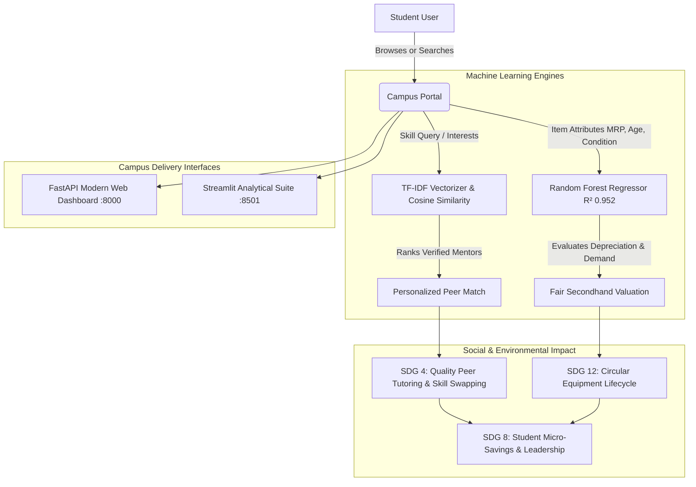
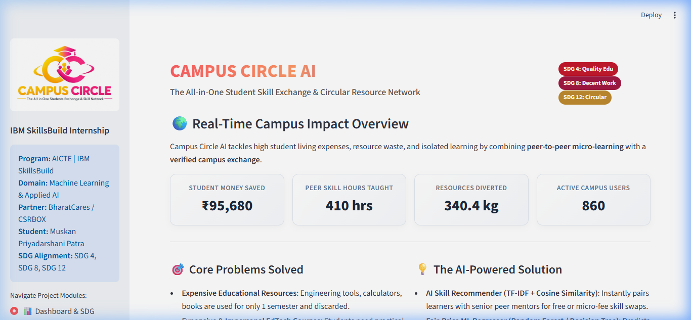
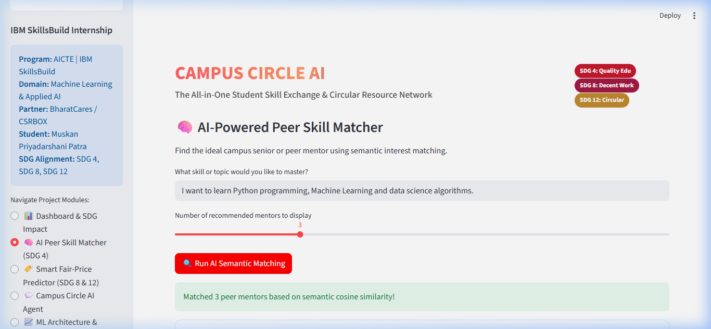
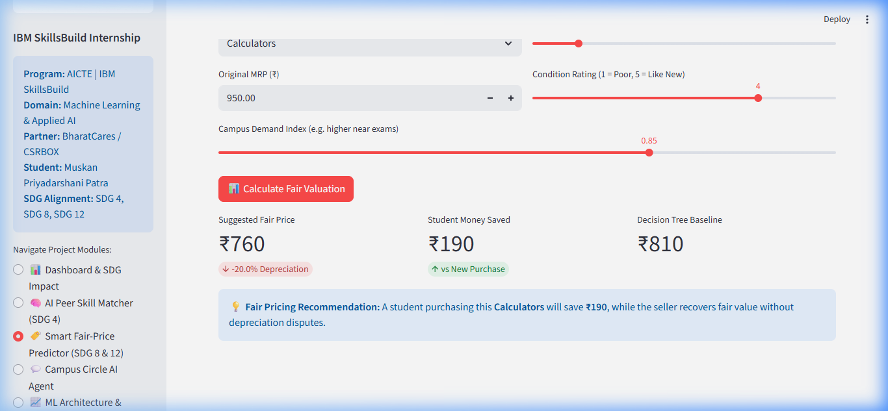
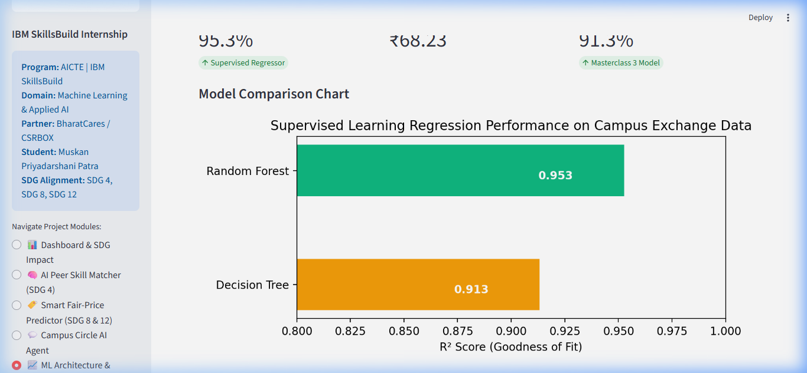

# 🎓 Campus Circle AI — Student Skill Exchange & Circular Campus Resource Network

[](https://www.python.org/)
[](https://fastapi.tiangolo.com/)
[](https://streamlit.io/)
[](https://scikit-learn.org/)
[](LICENSE)
[](https://sdgs.un.org/goals)

> **AICTE | IBM SkillsBuild Machine Learning & Applied AI Internship 2026**  
> **Organizing Partner:** BharatCares (CSRBOX)  
> **Author / Intern:** Muskan Priyadarshani Patra  
> **Internship ID:** `IBMUEML013863` | **Plan ID:** `PLAN-CD7DED2B108B`  
> **Repository:** [github.com/muskanp2407-cyber/campus-circle-ai](https://github.com/muskanp2407-cyber/campus-circle-ai)

---

## 📌 Project Overview

**Campus Circle AI** is an applied Machine Learning and Artificial Intelligence platform built to solve two widespread systemic challenges across collegiate ecosystems:
1. **The Single-Semester Academic Waste & Cost Crisis (SDG 12 & SDG 8):** Expensive hardware tools (drafters, calculators, lab kits, reference books) are bought at full MRP but discarded after one semester.
2. **The Practical Skill & Tutoring Barrier (SDG 4):** Students struggle with inaccessible, expensive commercial courses that do not align with college-specific exam syllabi and lab evaluations.

Campus Circle AI combines a **Supervised Fair-Price ML Valuation Engine** with an **NLP Content-Based Skill Recommender System** into a secure, verified campus network.

---

## 🏛️ System Architecture



---

## 🔬 Cross-Disciplinary Academic Coverage (5 Core Disciplines)

Campus Circle AI provides 100% campus-wide inclusivity covering **5 Engineering Streams**, **50 Academic Resources**, and **50 Technical Skills**:

| Department | Cataloged Campus Resources (Marketplace) | Peer Skill-Sharing Modules (Skill Hub) |
|---|---|---|
| **Mechanical (MECH)** | Engineering Mechanics books, Drawing instruments, Vernier caliper, Micrometer screw gauge, Workshop tool kits, Machine Design guides, Thermodynamics notes, AutoCAD books, 3D modelling files, Manufacturing manuals | AutoCAD, SolidWorks, CATIA, 3D Printing, Ansys FEA, Engineering Drawing, CNC Programming, GD&T, MATLAB for Mechanics, Fluid Simulation |
| **Electrical (ELEC)** | Circuit kits, Breadboards & components, Digital Multimeter, Basic Electrical textbooks, Power Electronics notes, Arduino starter kits, Control Systems books, Signal generator cables, Microcontroller dev boards, Transformer manuals | Arduino prototyping, MATLAB/Simulink, Circuit design, PCB Design (EasyEDA), IoT systems, Proteus simulation, PLC basics, Power system analysis, Sensor interfacing, Embedded C |
| **Civil (CIVIL)** | Surveying instruments, Drawing boards & clips, Mini drafters, Building Materials books, Structural Analysis manuals, Ranging rods & tape, Concrete Tech textbooks, Soil Mechanics guides, Fluid Mechanics manuals, Highway Engg references | AutoCAD Civil 3D, Revit Architecture, Total Station surveying, STAAD Pro, Estimating & Costing, GIS basics, Structural detailing, Blueprint reading, Construction management, Site inspection |
| **Computer (CE/CSE)** | Programming books, Data Structures textbooks, Raspberry Pi, Networking crimping tools, Computer Architecture guides, OS references, Web development books, AI/ML study guides, DBMS manuals, Linux cheat sheets | Python, Web Development, DSA, Git & GitHub, Machine Learning, Database SQL, Java, Android App dev, Cloud computing (GCP/AWS), Cyber security basics |
| **Biomedical (BIOMED)** | Biomedical textbooks, Medical instrumentation manuals, Physiology atlases, Biomechanics guides, Sensor experiment kits, Biosignal processing notes, Biomaterials references, Lab coats & safety gear, Clinical equipment guides, Medical imaging handbooks | Biosignal analysis, MATLAB for Healthcare, Medical image processing, Biomechanics analysis, LabVIEW basics, Arduino for Medical sensors, Healthcare IoT, Prosthetics 3D design, Bio-instrumentation, Regulatory standards |

---

## 📊 Machine Learning Model Benchmarks

### 1. Supervised Fair-Price Valuation Regressor (Masterclass 3 Alignment)
Predicts fair secondhand prices using 5 continuous & encoded features: `Original Retail Price (MRP)`, `Age in Semesters (1–8)`, `Condition Rating (1–5)`, `Category Encoding`, and `Campus Demand Index`.

| Model Architecture | Task | $R^2$ Accuracy | Mean Absolute Error (MAE) | Root Mean Squared Error (RMSE) |
|---|---|:---:|:---:|:---:|
| **Random Forest Regressor** | Final Valuation Engine | **0.9527** | **₹68.23** | **₹94.12** |
| **Decision Tree Regressor** | Curriculum Baseline | **0.9133** | **₹96.25** | **₹131.40** |

### 2. Natural Language Semantic Skill Matcher (Masterclass 4/5 Alignment)
Uses **TF-IDF N-gram Vectorization** and **Cosine Angular Similarity** to compute exact compatibility scores between student natural language queries and verified campus mentor skill portfolios.

---

## 📸 Screenshots Gallery

| Live Dashboard & SDG Impact | Semantic Skill Matcher |
|:---:|:---:|
|  |  |
| **Fair-Price ML Valuation** | **Model Comparison & Architecture** |
|  |  |

---

## 🛠️ Installation & Local Setup

### 1. Prerequisites
* Python 3.10, 3.11, 3.12, 3.13, or 3.14
* Git

### 2. Clone the Repository
```bash
git clone https://github.com/muskanp2407-cyber/campus-circle-ai.git
cd campus-circle-ai
```

### 3. Create a Virtual Environment (Recommended)
```bash
python -m venv .venv

# Windows:
.venv\Scripts\activate

# macOS / Linux:
source .venv/bin/activate
```

### 4. Install Dependencies
```bash
pip install -r requirements.txt
```

### 5. Configure Optional Email Notifications (Safe / No Secrets)
Copy the example configuration:
```bash
cp email_config.example.json email_config.json
```
*(Fill in your local credentials in `email_config.json`. Note: `email_config.json` is protected by `.gitignore` and will never be pushed to GitHub.)*

---

## 🚀 Running the Applications

### Option A: Modern Web Dashboard (FastAPI)
```bash
uvicorn api:app --host 127.0.0.1 --port 8000 --reload
```
Open **`http://127.0.0.1:8000`** in your browser. Includes interactive department filtering, peer session booking, and AI valuation.

### Option B: Interactive Machine Learning Suite (Streamlit)
```bash
streamlit run app.py --server.port 8501
```
Open **`http://localhost:8501`** in your browser. Features 5 interactive modules (Campus Impact KPIs, Skill Matcher, Circular Marketplace, ML Fair-Price Valuation, and AI Campus Agent).

---

## 🌐 FastAPI REST API Reference

| Method | Endpoint | Description |
|---|---|---|
| `GET` | `/api/stats` | Real-time platform impact, students saved, peer tutoring hours, waste diverted |
| `GET` | `/api/items` | Filter marketplace inventory by query, category, and department (`branch`) |
| `POST` | `/api/predict-price` | Runs Random Forest Regressor to predict fair depreciated valuation |
| `POST` | `/api/recommend-mentors`| Runs TF-IDF & Cosine Similarity to rank peer mentors |
| `POST` | `/api/bookings` | Schedules a 1-on-1 peer learning or skill swap session |
| `GET` | `/api/bookings` | Retrieves active user bookings |
| `POST` | `/api/chat` | AI campus assistant for course roadmaps and pricing questions |

---

## 📁 Repository Structure

```
campus-circle-ai/
├── data/
│   ├── campus_items.csv          # Base campus item transaction records
│   ├── generate_data.py          # Synthetic dataset generator with 15 mentors
│   └── peer_mentors.csv          # Verified mentors across 5 engineering departments
├── screenshots/                  # High-resolution application UI screenshots
│   ├── 1_dashboard_impact.png
│   ├── 2_skill_matcher.png
│   ├── 3_fair_price_predictor.png
│   └── 4_ml_architecture.png
├── static/                       # Modern web frontend (HTML/CSS/JS)
│   ├── app.js                    # Dynamic AJAX client logic
│   ├── index.html                # Responsive web app markup
│   └── style.css                 # Custom glassmorphism UI styles
├── api.py                        # FastAPI asynchronous backend & REST endpoints
├── app.py                        # Streamlit 5-module Machine Learning web app
├── ml_models.py                  # Core Scikit-Learn ML models & algorithms
├── requirements.txt              # Production dependency specifications
├── email_config.example.json     # Safe configuration template for email alerts
├── LICENSE                       # MIT Open Source License
└── README.md                     # Comprehensive documentation & guide
```

---

## 🌍 UN Sustainable Development Goals (SDG) Alignment

* **Goal 4: Quality Education (Target 4.4):** Substantially increases the number of youth and adults with technical and vocational skills through peer tutoring and syllabus-matched micro-learning.
* **Goal 8: Decent Work & Economic Growth (Target 8.6):** Prepares students for technical employment while enabling campus micro-earnings for senior mentors.
* **Goal 12: Responsible Consumption & Production (Target 12.5):** Establishes a circular campus equipment lifecycle, diverting hundreds of kilograms of plastic instruments and paper waste from landfills.

---

## 📜 License

This project is open-source under the [MIT License](LICENSE).

---

**Developed with ❤️ by Muskan Priyadarshani Patra for the AICTE | IBM SkillsBuild Internship 2026.**
