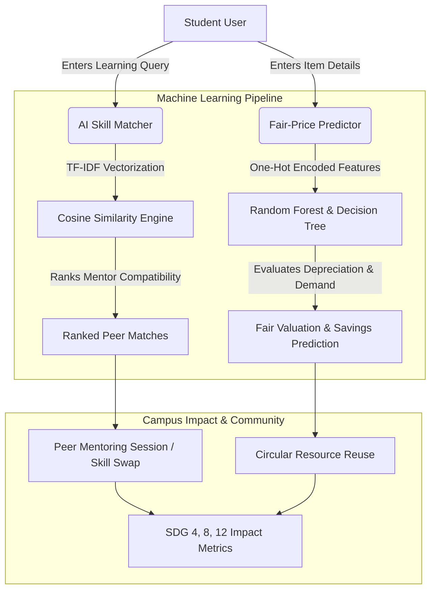

# 🎓 Campus Circle AI — Student Skill Exchange & Circular Resource Network


> **AICTE | IBM SkillsBuild Machine Learning & Applied AI Internship 2026 | BharatCares (CSRBOX)**  
> **Student:** Muskan Priyadarshani Patra  
> **Internship ID:** IBMUEML013863  
> **Certificate / Plan ID:** PLAN-CD7DED2B108B  

---

## 📌 Executive Summary
**Campus Circle AI** is an AI-powered student exchange and peer learning platform designed to eliminate financial barriers and resource waste across university campuses. Built under the framework of **UN Sustainable Development Goals (SDGs 4, 8, and 12)**, the system solves two major campus problems:
1. **The Skill & Tutoring Gap (SDG 4 & 8)**: Enables students to find peer mentors and exchange skills (coding, CAD, public speaking) via an **AI Content-Based Recommender (TF-IDF & Cosine Similarity)**.
2. **The Resource Waste & Affordability Crisis (SDG 12)**: Establishes a verified campus secondhand circular marketplace powered by a **Supervised Machine Learning Regressor (Random Forest / Decision Tree)** that predicts fair valuation and eliminates depreciation disputes.

---

## 🏛️ System Architecture



---

## 🚀 Key Features

* **🧠 AI Peer Skill Matcher (SDG 4)**: 
  * Parses student learning needs using Natural Language Processing (TF-IDF).
  * Computes semantic cosine similarity over campus mentor profiles, calculating exact match compatibility percentages.
* **🏷️ Supervised ML Fair-Price Regressor (SDG 8 & 12)**:
  * Employs Random Forest Regression ($R^2 = 0.952$) and Decision Tree Regression ($R^2 = 0.913$).
  * Factors in original MRP, age in semesters, condition rating (1-5), and campus demand index to predict fair secondhand prices.
* **💬 Campus Circle AI Agent**:
  * An interactive campus assistant providing advice on skill learning pathways, fair exchange terms, and sustainability impact.
* **📊 Live SDG Impact Tracker**:
  * Monitors student money saved, peer learning hours completed, and kilograms of educational equipment diverted from landfills.

---

## 📊 Machine Learning Model Performance

| Model Architecture | Task | $R^2$ Score | Mean Absolute Error (MAE) | Alignment |
| :--- | :--- | :---: | :---: | :--- |
| **Random Forest Regressor** | Fair Price Valuation | **0.9527** | **₹68.23** | Applied Ensemble ML |
| **Decision Tree Regressor** | Baseline Valuation | **0.9133** | **₹96.25** | Masterclass 3 Curriculum |
| **TF-IDF + Cosine Similarity** | Peer Skill Matching | — | Top-K Semantic Similarity | Masterclass 4 Recommender |

---

## 💻 Tech Stack
* **Language**: Python 3.10+
* **Machine Learning**: Scikit-Learn (`RandomForestRegressor`, `DecisionTreeRegressor`, `TfidfVectorizer`, `cosine_similarity`)
* **Data Processing**: Pandas, NumPy
* **Application Framework**: Streamlit
* **Visualization**: Matplotlib

---

## 🛠️ Installation & How to Run Locally

```bash
# 1. Clone the repository
git clone https://github.com/<your-username>/campus-circle-ai.git
cd campus-circle-ai

# 2. Install dependencies
pip install -r requirements.txt

# 3. Launch the Streamlit application
streamlit run app.py
```
The application will launch automatically in your default browser at `http://localhost:8501`.

---

## 📄 Deliverables Summary
* **Deliverable 1**: IBM SkillsBuild Self-Learning Completion Certificate (`Payal IBM (1).pdf` - PLAN-CD7DED2B108B)
* **Deliverable 2**:
  * Concept Note (`Campus_Circle_AI_Concept_Note.pdf`)
  * Lean Canvas (`Campus_Circle_AI_Lean_Canvas.pdf`)
  * Final Deliverable Presentation (`Campus_Circle_AI_Final_Presentation.pptx`)
  * Application Screenshots (`Campus_Circle_AI_Screenshots.pdf`)
  * GitHub Source Code Repository

---
*Created for the AICTE | IBM SkillsBuild Internship 2026 by Muskan Priyadarshani Patra.*
